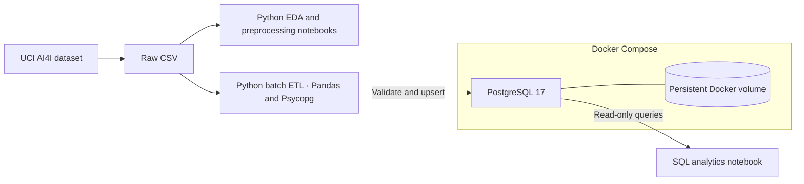

# IndustryPulseAI

## Project Overview

IndustryPulseAI is a predictive maintenance portfolio project built around the AI4I 2020 dataset. The current implementation ingests industrial sensor measurements into PostgreSQL, validates the loaded data, and analyzes observed machine failures. The long-term goal is to estimate machine failure risk from operational measurements.

## Project Objectives

- Build a reproducible path from a raw dataset to a queryable relational database.
- Enforce data quality at ingestion and in the database.
- Verify repeatable batch loads and compare SQL results with exploratory analysis.
- Prepare a feature and target view for future model development.

## System Architecture



## Technology Stack

| Layer | Technologies |
|---|---|
| Ingestion and validation | Python 3.12, Pandas, Psycopg 3, python-dotenv |
| Storage and local runtime | PostgreSQL 17, Docker Compose |
| Analysis and preprocessing | Jupyter, SQL, NumPy, Matplotlib, Seaborn, scikit-learn |
| Testing | Python unittest |

## Dataset

The AI4I 2020 Predictive Maintenance Dataset is synthetic and represents industrial maintenance scenarios. It contains 10,000 records and 14 source columns, including product type, five sensor measurements, the machine failure target, and five failure-mode indicators. The observed failure rate is 3.39% (339 of 10,000 records).

The original CSV is included under `data/raw/` and is unchanged. Dataset citation and license apply to the dataset. [AI4I 2020 Predictive Maintenance Dataset (2020), UCI Machine Learning Repository](https://archive.ics.uci.edu/dataset/601/ai4i) · [DOI 10.24432/C5HS5C](https://doi.org/10.24432/C5HS5C) · [CC BY 4.0](https://creativecommons.org/licenses/by/4.0/)

## Database Schema

| Object | Purpose |
|---|---|
| `product_types` | Product type lookup keyed by `type_code`. |
| `sensor_readings` | Sensor measurements keyed by UDI and linked to a product type. |
| `failure_records` | Machine failure target and failure-mode indicators linked by UDI. |
| `ml_training_data` | View of six input features and the machine failure target. |

The schema includes primary and foreign keys, domain checks, and an index on the sensor readings' product type. See the [schema and ER diagram](docs/database_schema.md).

## ETL Pipeline

The batch pipeline reads the original CSV, maps columns to the database schema, and validates identifiers, measurements, and labels. Psycopg upserts the three tables in dependency order. The pipeline verifies table counts and label counts before committing. A failed write or count check rolls back the batch. The same input produces the same database contents on repeated runs. See the [ETL documentation](docs/etl_pipeline.md).

## Data Quality and Validation

- Required columns, missing values, duplicate identifiers, product types, and binary labels are validated before loading.
- Air and process temperatures remain in kelvin, rotational speed in rpm, torque in N·m, and tool wear in minutes.
- The loaded dataset contains 3 product types, 10,000 sensor readings, and 10,000 failure records. Of those, 9,661 are labeled normal and 339 are labeled failed.
- The training view excludes record identifiers and failure-mode indicators. The SQL analytics notebook cross-checks its results against the source CSV.

## Installation and Setup

Prerequisites are Git, Python 3.12, and a running Docker Engine with Docker Compose. On Windows, run the following in PowerShell.

```powershell
git clone https://github.com/talhaondrr/IndustryPulseAI.git
Set-Location IndustryPulseAI
py -3.12 -m venv .venv
.\.venv\Scripts\python.exe -m pip install -r requirements.txt
Copy-Item .env.example .env
```

Set a strong local `POSTGRES_PASSWORD` in `.env`. The default database endpoint is `127.0.0.1:5432`. Then start the database and load the dataset.

```powershell
docker compose up -d --wait
.\.venv\Scripts\python.exe -m src.init_database
.\.venv\Scripts\python.exe -m pipelines.etl_pipeline
```

If the CSV is missing, run `.\.venv\Scripts\python.exe -m src.download_data` before running the ETL. To rerun the notebooks, open them with the project's Python environment. Start with [exploratory analysis](notebooks/01_exploratory_data_analysis.ipynb), then see [preprocessing](notebooks/02_data_preprocessing.ipynb) and [SQL analytics](notebooks/03_sql_analytics.ipynb).

## Test Results

All 12 tests passed: 4 PostgreSQL schema tests, 6 ETL tests, and 2 preprocessing tests. Integration tests check constraints, the training view, rollback, and idempotent loading against the PostgreSQL service.

```powershell
.\.venv\Scripts\python.exe -m unittest discover -s tests -v
```

## Current Development Status

- Local PostgreSQL infrastructure with persistent storage and a health check.
- Relational schema and training view, with an executable schema initializer.
- Validated, transactional batch ETL and repeatable loads.
- Exploratory data analysis, reproducible preprocessing, and executed SQL analytics with charts and query plans.

## Future Roadmap

1. Train and evaluate a baseline machine failure classifier with metrics suited to class imbalance.
2. Add automated test execution and data quality checks.
3. Evaluate orchestration and model serving after the batch workflow and baseline are established.
