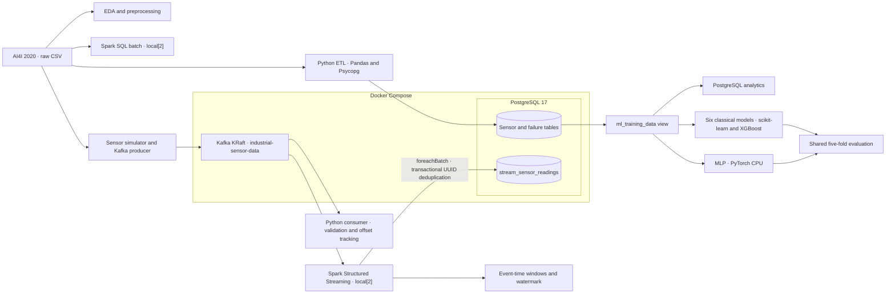
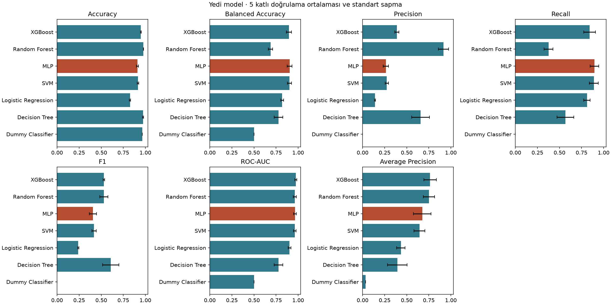

# IndustryPulseAI

IndustryPulseAI is a predictive maintenance portfolio project that combines PostgreSQL batch ingestion, model evaluation, and simulated sensor streaming. The AI4I 2020 dataset is synthetic. The reported model results do not guarantee performance in real factories.

## System architecture



## Dataset and storage

The dataset contains 10,000 measurements and 14 source columns. There are 339 failure labels (3.39%). PostgreSQL stores product types, sensor readings, and failure labels separately. The training view exposes six input features and the binary target. Identifiers and failure-mode flags are excluded from model inputs. Simulated events are written only to the separate streaming table. [Dataset and license](https://archive.ics.uci.edu/dataset/601/ai4i) · [Database schema](docs/database_schema.md) · [ETL guide](docs/etl_pipeline.md)

## Model results

The same stratified 80/20 split with seed 42 produced 8,000 training and 2,000 held-out records. All seven models used the same five stratified training folds. Preprocessing was fitted on each fold's training partition. The table shows fold means, ranked by Average Precision.

| Model | Accuracy | Balanced accuracy | Precision | Recall | F1 | ROC-AUC | Average Precision |
| --- | ---: | ---: | ---: | ---: | ---: | ---: | ---: |
| **XGBoost** | 0.9496 | 0.8973 | 0.3902 | 0.8412 | 0.5314 | 0.9740 | **0.7643** |
| Random Forest | 0.9776 | 0.6874 | 0.9158 | 0.3761 | 0.5309 | 0.9625 | 0.7515 |
| MLP | 0.9108 | 0.9040 | 0.2636 | 0.8968 | 0.4069 | 0.9641 | 0.6759 |
| SVM | 0.9163 | 0.9032 | 0.2745 | 0.8892 | 0.4190 | 0.9624 | 0.6442 |
| Logistic Regression | 0.8263 | 0.8192 | 0.1412 | 0.8116 | 0.2405 | 0.9030 | 0.4341 |
| Decision Tree | 0.9753 | 0.7787 | 0.6563 | 0.5679 | 0.6076 | 0.7787 | 0.3934 |
| Dummy Classifier | 0.9661 | 0.5000 | 0.0000 | 0.0000 | 0.0000 | 0.5000 | 0.0339 |

XGBoost was selected using cross-validation and then evaluated on the held-out set. Those test results were already known when the MLP experiment began. MLP development used only the training folds.

| Held-out model | Accuracy | Balanced accuracy | Precision | Recall | F1 | ROC-AUC | Average Precision |
| --- | ---: | ---: | ---: | ---: | ---: | ---: | ---: |
| XGBoost | 0.9550 | 0.9270 | 0.4236 | 0.8971 | 0.5755 | 0.9842 | 0.8429 |

XGBoost detected 61 of 68 failures. The confusion matrix contains 1,849 true negatives, 83 false positives, 7 false negatives, and 61 true positives. [Seven-model metrics](results/mlp/model_comparison.csv) · [Held-out metrics](results/test_metrics.csv) · [Confusion matrix](results/confusion_matrix.png) · [ROC](results/roc_curve.png) · [Precision–Recall](results/precision_recall_curve.png)



## Kafka and Spark validation

The single Kafka 4.2.2 KRaft broker uses the optional `streaming` Compose profile, one partition, and replication factor 1. Sensor events carry a UUID and UTC timestamp. The Kafka producer and consumer audit delivered all 100 unique events with zero loss and zero duplicates.

Spark and PySpark 4.1.2 run with Java 17 in **`local[2]`** mode. Spark SQL matched the results of nine PostgreSQL analytical queries. Structured Streaming verified another 100 new Kafka events in PostgreSQL, isolated from earlier Kafka messages by their starting offset. Restarting Spark with the same checkpoint consumed zero old events. Replaying the 100 events inserted zero duplicate rows. The tests also covered invalid data and transaction rollback.

The pipeline logs micro-batch counts and sensor averages. A separate query demonstrates one-minute event-time windows and a two-minute watermark. `foreachBatch` provides at-least-once writes. A UUID primary key and transactional inserts make the PostgreSQL sink idempotent. [Kafka guide](docs/kafka_streaming.md) · [Spark guide](docs/spark_processing.md) · [Streaming table schema](sql/03_streaming_schema.sql)

## Local setup

Use Python 3.12, Docker Compose, and Java 17 for Spark. From the project root in PowerShell:

```powershell
py -3.12 -m venv .venv
.\.venv\Scripts\python.exe -m pip install -r requirements.txt
Copy-Item .env.example .env
```

Set your local PostgreSQL password in `.env`, then start PostgreSQL and load the dataset.

```powershell
docker compose up -d --wait postgres
.\.venv\Scripts\python.exe -m src.init_database
.\.venv\Scripts\python.exe -m pipelines.etl_pipeline
```

The Kafka guide shows how to start the optional broker and create the topic. The Spark guide provides native Java and one-shot Linux runner instructions, including a Windows fallback when native Hadoop components are unavailable. [Kafka setup](docs/kafka_streaming.md#yerel-kurulumu-başlatma) · [Spark setup](docs/spark_processing.md#çalıştırma)

## Verification

**29 tests passed** for the published scope. The Windows Python environment ran 25 tests, including Kafka integration. The one-shot Linux Spark runner ran four additional Spark tests, including Kafka-to-PostgreSQL delivery and recovery. [Test commands and resource measurements](docs/spark_processing.md)

## Notebooks and artifacts

| Stage | Executed notebook | Guide or artifact |
| --- | --- | --- |
| Exploratory analysis | [01 · EDA](notebooks/01_exploratory_data_analysis.ipynb) | [Raw data](data/raw/ai4i2020.csv) |
| Preprocessing | [02 · Preprocessing](notebooks/02_data_preprocessing.ipynb) | [Preprocessing module](src/preprocessing.py) |
| PostgreSQL analytics | [03 · SQL analytics](notebooks/03_sql_analytics.ipynb) | [SQL queries](sql/02_analytics_queries.sql) |
| Classical models | [04 · Machine learning](notebooks/04_machine_learning.ipynb) | [Guide](docs/machine_learning.md) · [CV charts](results/model_comparison.png) |
| Neural network | [05 · MLP](notebooks/05_mlp_deep_learning.ipynb) | [Guide](docs/deep_learning.md) · [MLP figures](results/mlp/) |
| Batch and streaming | [06 · Spark](notebooks/06_spark_data_processing.ipynb) | [Guide](docs/spark_processing.md) |
