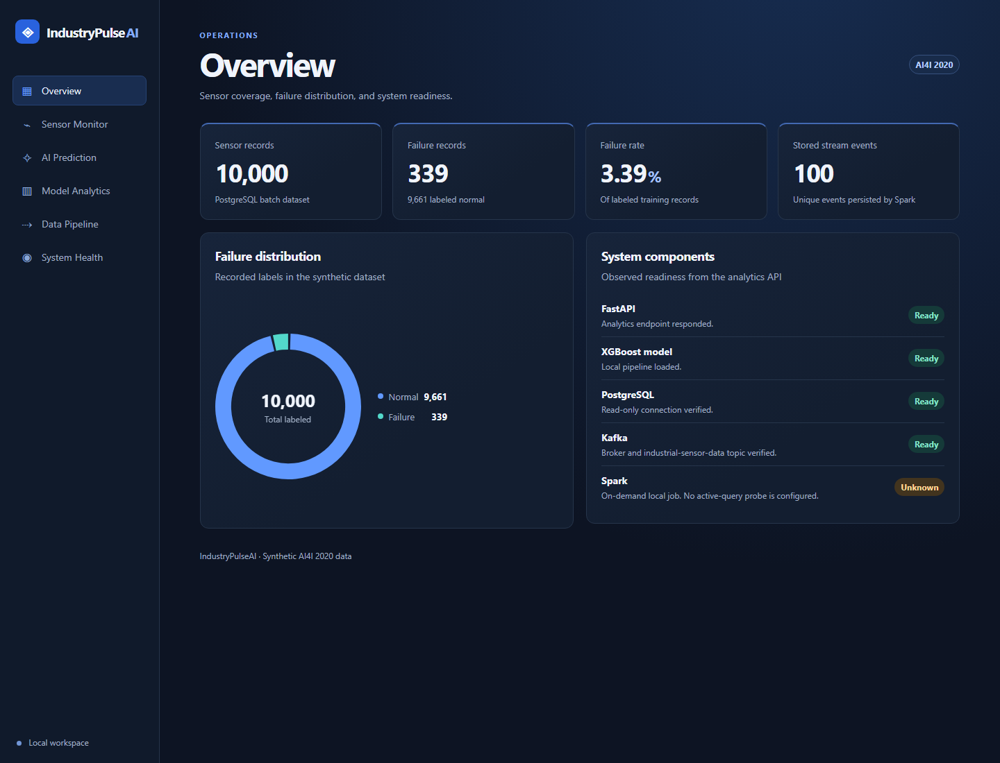
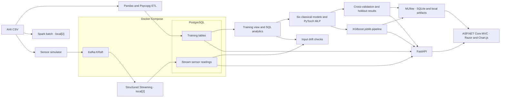
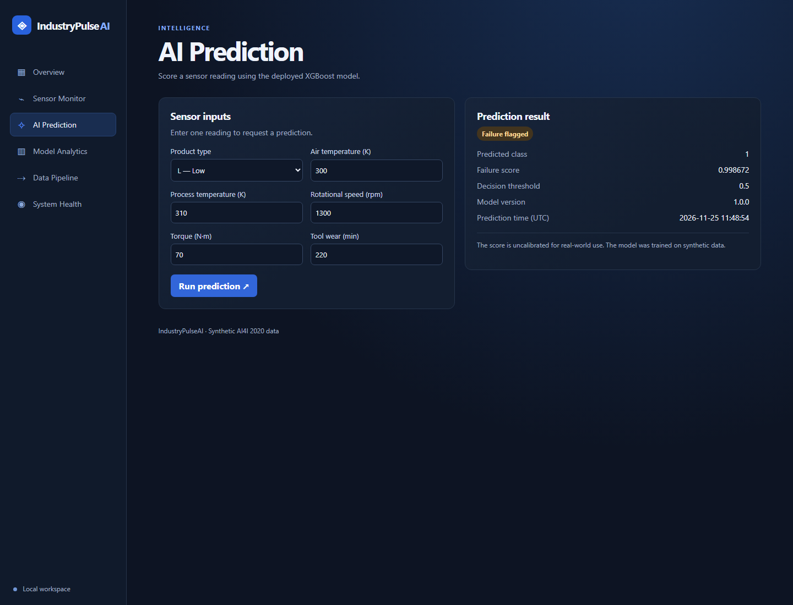
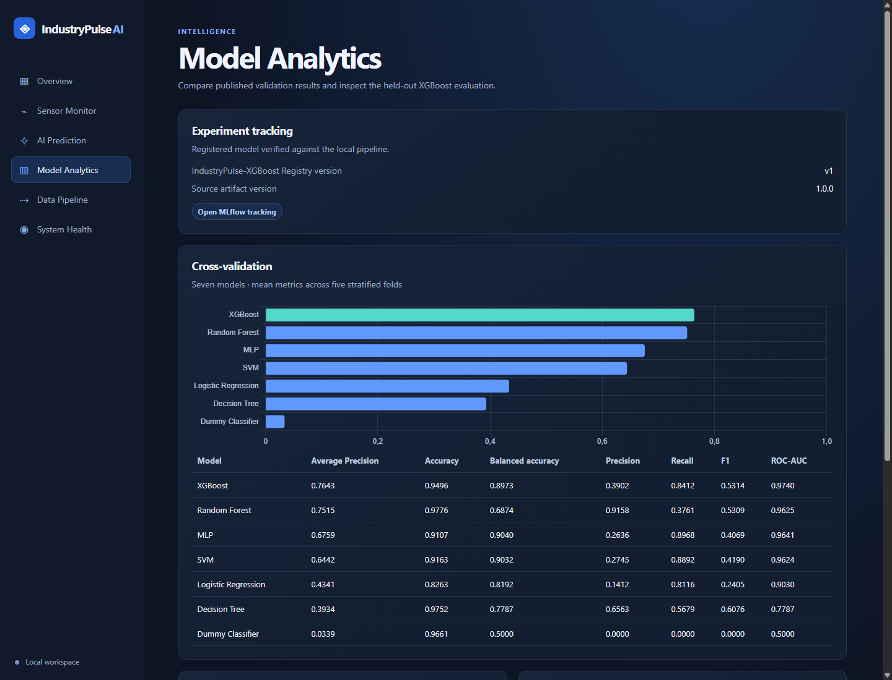

# IndustryPulseAI

[](https://github.com/talhaondrr/IndustryPulseAI/actions/workflows/ci.yml)

## Project Overview

IndustryPulseAI is a local predictive-maintenance portfolio project. It traces synthetic industrial measurements from batch ingestion and event streaming through model evaluation, inference, and experiment tracking.



## Business Problem

Maintenance teams need to distinguish rare failures from ordinary operating variation. The project demonstrates how to collect measurements, compare classifiers under class imbalance, and present predictions with enough context to interpret them.

## Key Features

- PostgreSQL schema, transactional ETL, and reproducible SQL analytics.
- Kafka sensor replay and Spark Structured Streaming with checkpoint recovery.
- Six classical classifiers and a PyTorch MLP evaluated on shared folds.
- XGBoost inference through FastAPI and a six-page ASP.NET Core MVC dashboard.
- MLflow experiment tracking, model verification, and label-free drift checks.

## End-to-End System Architecture



## Technology Stack

| Layer | Technology |
| --- | --- |
| Data and runtime | Python 3.12, Pandas, Psycopg, PostgreSQL 17, Docker Compose |
| Streaming | Apache Kafka 4.2.2, PySpark 4.1.2, Java 17 |
| Modeling | scikit-learn, XGBoost 3.2.0, PyTorch CPU, joblib |
| Serving and UI | FastAPI, Pydantic, Uvicorn, .NET 10 MVC, Razor, Chart.js |
| MLOps and verification | MLflow 3.18.0, SQLite, unittest, GitHub Actions |

## Dataset

AI4I 2020 is synthetic and includes 10,000 records, five sensor measurements, product type, a binary failure label, and failure-mode flags. It contains 339 labeled failures (3.39%). Models use six input features. Record identifiers and failure-mode flags are excluded. [Raw CSV](data/raw/ai4i2020.csv)

## Database Schema

| Object | Purpose |
| --- | --- |
| `product_types`, `sensor_readings`, `failure_records` | Batch measurements and observed labels |
| `ml_training_data` | Six model inputs and the binary target |
| `stream_sensor_readings` | Unlabeled simulated events, keyed by UUID |

[Schema and relationships](docs/database_schema.md) · [SQL analytics](sql/02_analytics_queries.sql)

## Batch ETL Pipeline

The ETL validates the CSV, maps fields to PostgreSQL, and performs transactional upserts. Count or integrity errors trigger rollback. Replaying the same dataset leaves stored values unchanged. Spark SQL independently reproduced nine PostgreSQL analytical results. [ETL guide](docs/etl_pipeline.md) · [Executed analytics notebook](notebooks/03_sql_analytics.ipynb)

## Kafka and Spark Streaming

A single Kafka KRaft broker carries UUID-keyed JSON sensor events. Spark runs in **`local[2]`**, validates events, reports micro-batch statistics, and writes using Psycopg transactions. A separate query demonstrates event-time windows and watermarks. Spark checkpoints track source progress and the UUID key deduplicates replayed writes. `foreachBatch` provides at-least-once delivery.

Local verification delivered 100 unique Kafka events with zero loss or duplication. The Spark integration separately stored 100 new events, recovered through a checkpoint, and inserted zero duplicate rows on replay. [Kafka guide](docs/kafka_streaming.md) · [Spark guide](docs/spark_processing.md) · [Spark notebook](notebooks/06_spark_data_processing.ipynb)

## Machine Learning and Deep Learning

A stratified 80/20 split with seed 42 reserved 2,000 records for testing. All seven models used the same five stratified training folds. Preprocessing was fitted only within each fold's training slice. The CPU MLP uses an 8→32→16→1 architecture and 50 epochs. [Classical models notebook](notebooks/04_machine_learning.ipynb) · [MLP notebook](notebooks/05_mlp_deep_learning.ipynb)

## Model Performance

The table reports mean cross-validation metrics on training folds, ordered by Average Precision.

| Model | Accuracy | Balanced accuracy | Precision | Recall | F1 | ROC-AUC | Average Precision |
| --- | ---: | ---: | ---: | ---: | ---: | ---: | ---: |
| **XGBoost** | 0.9496 | 0.8973 | 0.3902 | 0.8412 | 0.5314 | 0.9740 | **0.7643** |
| Random Forest | 0.9776 | 0.6874 | 0.9158 | 0.3761 | 0.5309 | 0.9625 | 0.7515 |
| MLP | 0.9108 | 0.9040 | 0.2636 | 0.8968 | 0.4069 | 0.9641 | 0.6759 |
| SVM | 0.9163 | 0.9032 | 0.2745 | 0.8892 | 0.4190 | 0.9624 | 0.6442 |
| Logistic Regression | 0.8263 | 0.8192 | 0.1412 | 0.8116 | 0.2405 | 0.9030 | 0.4341 |
| Decision Tree | 0.9753 | 0.7787 | 0.6563 | 0.5679 | 0.6076 | 0.7787 | 0.3934 |
| Dummy Classifier | 0.9661 | 0.5000 | 0.0000 | 0.0000 | 0.0000 | 0.5000 | 0.0339 |

On its separate holdout, XGBoost achieved Accuracy **0.9550**, Balanced Accuracy **0.9270**, Precision **0.4236**, Recall **0.8971**, F1 **0.5755**, ROC-AUC **0.9842** and Average Precision **0.8429**. The confusion matrix contains 1,849 true negatives, 83 false positives, 7 false negatives and 61 true positives. The holdout had already been evaluated before MLP development. The MLP comparison uses cross-validation only. [Seven-model CSV](results/mlp/model_comparison.csv) · [Holdout CSV](results/test_metrics.csv) · [Confusion matrix](results/confusion_matrix.png)

## FastAPI Documentation

The local API exposes health, model metadata, single and batch predictions, and read-only analytics. XGBoost classifies scores above 0.5 as failures. Load the bundled joblib artifact only from the trusted project source. A local export can recreate it from PostgreSQL.

```json
{"type":"M","air_temperature":298.1,"process_temperature":308.6,"rotational_speed":1551,"torque":42.8,"tool_wear":0}
```

Send this payload to `POST /predict`. It returns class `0` and a score of approximately `0.001382`. [Swagger on localhost](http://127.0.0.1:8000/docs) · [API guide and examples](docs/api_documentation.md)

## MVC Dashboard

The dashboard uses a typed HttpClient to call FastAPI. It includes Overview, Sensor Monitor, AI Prediction, Model Analytics, Data Pipeline, and System Health. Sensor Monitor polls recent stored events and reports when they have not changed. Model Analytics separates cross-validation from holdout results, and keeps the published metrics visible if MLflow is offline. [Dashboard on localhost](http://127.0.0.1:5080/) · [MVC guide](docs/mvc_dashboard.md)

## MLOps and MLflow

The IndustryPulseAI experiment contains seven imported cross-validation runs and a separate XGBoost holdout run. Identical imports reuse the same run IDs. **IndustryPulse-XGBoost v1** matched the local XGBoost artifact on all 8,000 training records. MLflow stores metadata in local SQLite and serves local artifacts.

Monitoring compares stream inputs against the training reference using the KS statistic and total variation distance. Both temperature features crossed the example review thresholds in the 100-event snapshot. The stream does not contain observed failure labels. [MLflow on localhost](http://127.0.0.1:5000/) · [MLOps guide](docs/mlops_guide.md) · [Executed notebook](notebooks/07_mlops_mlflow.ipynb)

## Testing and CI

**Local verification:** 45 Python tests passed across Windows and the one-shot Linux Spark runner. The Release MVC build completed with zero errors and warnings. Browser smoke tests cover Dashboard pages and a real prediction. [Spark test setup](docs/spark_processing.md) · [Dashboard verification](docs/mvc_dashboard.md) · [MLflow verification](docs/mlops_guide.md)

**GitHub Actions** runs Python with disposable PostgreSQL and MLflow, builds the MVC project, and runs Kafka and Spark in a separate integration job. The core Python job reports the dedicated integration cases as skipped. The streaming job runs those cases with real services. The badge links to the remote run history, independent of local results. [Workflow](.github/workflows/ci.yml)

## Installation and Setup

Use Python 3.12, .NET 10 SDK, Docker Desktop with Compose, and Java 17 for native Spark. The Windows Spark fallback uses the existing one-shot Linux runner.

```powershell
git clone https://github.com/talhaondrr/IndustryPulseAI.git
Set-Location IndustryPulseAI
py -3.12 -m venv .venv
.\.venv\Scripts\python.exe -m pip install -r requirements.txt
Copy-Item .env.example .env
```

Set a local PostgreSQL password in `.env`. On a fresh clone, `-Initialize` creates the schema and loads the CSV. Omit that flag for an existing database. Docker Desktop must be running first.

```powershell
powershell -NoProfile -ExecutionPolicy Bypass -File scripts/start-local.ps1 -Initialize
```

Startup order is PostgreSQL and Kafka, database initialization when requested, FastAPI, MLflow, then MVC. To populate MLflow and the sensor feed, run the following commands from separate terminals as needed.

```powershell
.\.venv\Scripts\python.exe -m mlops.register_model
.\.venv\Scripts\python.exe -m streaming.kafka_producer --count 100 --interval 0.1
.\.venv\Scripts\python.exe -m streaming.spark_streaming --available-now
```

Spark runs on demand. Windows users without native Hadoop libraries can follow the [Linux runner instructions](docs/spark_processing.md#windowsta-yerel-çalıştırıcı). The stop script stops application processes it launched. Add `-StopInfrastructure` to stop the Compose containers while retaining their volumes.

```powershell
powershell -NoProfile -ExecutionPolicy Bypass -File scripts/stop-local.ps1
```

## Screenshots

Captured from the running local services using synthetic data.

| Dashboard | Dashboard |
| --- | --- |
| [Overview](docs/screenshots/overview.png) | [Sensor Monitor](docs/screenshots/sensor-monitor.png) |
|  |  |
| [Data Pipeline](docs/screenshots/data-pipeline.png) | [System Health](docs/screenshots/system-health.png) |
| [FastAPI Swagger](docs/screenshots/fastapi-swagger.png) | [MLflow Training runs](docs/screenshots/mlflow.png) |

## Project Structure

| Path | Contents |
| --- | --- |
| `data/raw/`, `pipelines/`, `sql/` | Dataset, batch ingestion, schemas and queries |
| `streaming/` | Kafka replay and Spark batch/streaming |
| `src/`, `notebooks/`, `results/` | Training, executed notebooks and recorded metrics |
| `models/`, `api/` | Trusted deployment artifact, metadata and API |
| `dashboard/` | MVC application and browser checks |
| `mlops/`, `scripts/` | Experiment import, monitoring and local service lifecycle |
| `tests/`, `.github/workflows/`, `docs/` | Tests, CI and documentation |

## Limitations

AI4I 2020 is synthetic and the reported model metrics do not guarantee real factory performance. The prediction score is not a calibrated real-world failure probability. Kafka is single-broker, Spark uses local threads and the dashboard is intended for localhost. Stream events have no ground-truth labels. The MLflow Registry mirrors the verified artifact and FastAPI loads its local deployment copy.

## Future Improvements

Validate against independently labeled factory data, evaluate score calibration, and test operational alert thresholds with maintenance teams. Evaluate multi-broker recovery and production access controls before expanding beyond a local demonstration.

## Dataset Attribution

Stephan Matzka, **AI4I 2020 Predictive Maintenance Dataset**, UCI Machine Learning Repository, 2020. Licensed under CC BY 4.0. [Dataset](https://archive.ics.uci.edu/dataset/601/ai4i) · [DOI](https://doi.org/10.24432/C5HS5C) · [License](https://creativecommons.org/licenses/by/4.0/)
