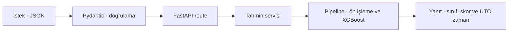

# XGBoost tahmin API’si

## Model ve çalışma şekli

XGBoost, önceki beş katlı çapraz doğrulamada en yüksek ortalama Average Precision değerini aldı. Model, aynı SQL sıralaması, tabakalı %80/%20 ayrım ve `random_state=42` ile seçilen 8.000 eğitim kaydında yeniden eğitildi. Ön işleme ve sınıflandırıcı aynı scikit-learn Pipeline içindedir. Ağaç sayısı 200, maksimum derinlik 4 ve öğrenme oranı 0,05 olarak korundu. XGBoost eğitimde sınıf dengeli örnek ağırlıklarını kullandı. Metadata’daki 0,7643 çapraz doğrulama AP ve 0,8429 bağımsız test AP değerleri önceki çalışmadan alınmıştır. Dışa aktarma aşamasında test kümesinden yeni performans ölçümü alınmadı.

API, model sürümü 1.0.0’ı başlangıçta sabit `models/` klasöründen yükler. Joblib yükleme sırasında Python kodu çalıştırabildiğinden yalnızca güvenilir yerel dışa aktarma dosyaları kullanılmalıdır. SHA-256 kontrolü model dosyasını metadata’daki özetle karşılaştırır ve yanlış eşleşmeyi deserialization öncesi yakalar. Dosyaların kaynağına güvenmek ayrıca gerekir. [Joblib yükleme referansı](https://joblib.readthedocs.io/en/stable/generated/joblib.load.html)

**`failure_score` XGBoost skorudur. Kalibre edilmiş gerçek dünya arıza olasılığı değildir.** Skor 0,5’i geçtiğinde model 1, diğer durumlarda 0 döndürür. AI4I 2020 verileri sentetiktir. Sonuçlar gerçek fabrika performansını garanti etmez.

## Yerel çalıştırma

PowerShell’de proje kökünden aşağıdaki komutları kullanın. PostgreSQL yalnızca modeli yeniden eğitirken gerekir. Uvicorn çalışırken hazır Pipeline ile tahmin yapılır.

```powershell
.\.venv\Scripts\python.exe -m pip install -r requirements.txt
# Model dosyalarını yeniden oluşturmak gerekiyorsa
.\.venv\Scripts\python.exe -m src.export_model
.\.venv\Scripts\python.exe -m uvicorn api.main:app --host 127.0.0.1 --port 8000
```

Swagger arayüzü `http://127.0.0.1:8000/docs`, makine tarafından okunabilir sözleşme ise `http://127.0.0.1:8000/openapi.json` adresindedir.

| Yöntem ve yol | İşlev | Başarı |
| --- | --- | ---: |
| `GET /` | API’ye ve dokümantasyona ait bağlantıları verir. | 200 |
| `GET /health` | HTTP servisinin ve yüklenen modelin durumunu bildirir. | 200 |
| `GET /model/info` | Eğitim tarihi, girdiler, sürümler ve geçmiş metrikleri verir. | 200 |
| `POST /predict` | Bir sensör kaydını değerlendirir. | 200 |
| `POST /predict/batch` | `readings` içinde 1–100 kayıt alır ve sonuçları giriş sırasıyla döndürür. | 200 |

## İstek ve yanıt örnekleri

`POST /predict` için `Content-Type: application/json` kullanın.

```json
{
  "type": "M",
  "air_temperature": 298.1,
  "process_temperature": 308.6,
  "rotational_speed": 1551,
  "torque": 42.8,
  "tool_wear": 0
}
```

`type` L, M veya H değerlerinden biridir. Sıcaklıklar kelvin ve sıfırdan büyüktür. Dönüş hızı rpm, tork N·m, takım aşınması dakika cinsindendir. Son üç ölçüm negatif olamaz. Dönüş hızı ve aşınma JSON tam sayısı olmalıdır. Sayılar sonlu olmalı ve modelin kullandığı sayısal aralığa sığmalıdır. Kimlikler, hedef etiketleri, arıza göstergeleri ve tanımsız alanlar `422` döndürür.

```powershell
$reading = @{
    type = 'M'; air_temperature = 298.1; process_temperature = 308.6
    rotational_speed = 1551; torque = 42.8; tool_wear = 0
}
$base = 'http://127.0.0.1:8000'
Invoke-RestMethod -Uri "$base/predict" -Method Post -ContentType 'application/json' -Body ($reading | ConvertTo-Json)
$second = @{
    type = 'L'; air_temperature = 300.0; process_temperature = 310.0
    rotational_speed = 1300; torque = 70.0; tool_wear = 220
}
$batch = @{readings = @($reading, $second)} | ConvertTo-Json -Depth 4
Invoke-RestMethod -Uri "$base/predict/batch" -Method Post -ContentType 'application/json' -Body $batch
```

Yukarıdaki tekil istek için gözlenen yanıt şöyleydi. Zaman alanı her istekte yeniden üretilir.

```json
{
  "predicted_class": 0,
  "failure_score": 0.001381733687594533,
  "decision_threshold": 0.5,
  "model_version": "1.0.0",
  "prediction_timestamp": "2026-11-25T10:32:31.555380Z"
}
```

Toplu tahmin aynı nesneleri `predictions` dizisinde, istek sırasıyla döndürür. Yukarıdaki ikinci kayıt sınıf 1 ve `0.9986718893051147` skoruyla döndü. Bir kayıt geçersizse tüm toplu istek `422` alır. Model dosyası yoksa veya doğrulanamazsa sağlık, model bilgi ve geçerli tahmin istekleri `503` alır. Dosyalar hazır olduktan sonra Uvicorn’u yeniden başlatın.

API testleri proje kökünden çalıştırılabilir.

```powershell
.\.venv\Scripts\python.exe -m unittest discover -s tests -p test_api.py -v
```

## Başlangıç kavramları

| Kavram | Bu projedeki karşılığı |
| --- | --- |
| **Model Deployment** | Eğitilen modeli başka bir programın kullanabileceği tahmin servisine yerleştirmek. |
| **Model Serialization** | Öğrenilmiş Pipeline’ı diske joblib dosyası olarak yazmak ve tekrar yükleyebilmek. |
| **Inference** | Hazır modelden yeni sensör girdisi için skor ve sınıf üretmek. Bu sırada model yeniden eğitilmez. |
| **REST API** | HTTP üzerinden kaynaklara ve işlemlere ulaşmak için kullanılan arayüz yaklaşımı. |
| **FastAPI** | Python işlevlerini HTTP üzerinden sunan ve tiplerden API sözleşmesi üreten framework. |
| **Endpoint** | `POST /predict` gibi HTTP yöntemi ve yolun birleşimi. |
| **HTTP GET ve POST** | GET ile sağlık veya model bilgisi okunur. POST ile tahmin için JSON gövdesi gönderilir. |
| **Request ve Response** | İstemciden gelen istek ve sunucunun durum koduyla birlikte döndürdüğü yanıt. |
| **JSON** | Alanları ve değerleri istemciyle sunucu arasında taşıyan metin biçimi. |
| **Pydantic** | Girdilerin gerekli alanları ve beklenen tipleri taşıdığını doğrular. |
| **Swagger** | OpenAPI sözleşmesini tarayıcıda gösteren ve istek göndermeyi sağlayan arayüz. |
| **HTTP Status Codes** | 200 başarı, 422 geçersiz istek, 503 geçici olarak kullanılamayan model anlamına gelir. |
| **Separation of Concerns** | HTTP yönlendirmesi, girdi doğrulaması ve Pipeline tahmini ayrı modüllerde yapılır. |
| **MVC** | Model veriyi ve iş kurallarını, View kullanıcıya gösterilen temsili, Controller gelen isteğin hangi işleme gideceğini yönetir. Bu API’de route katmanı Controller rolüne benzer. |



[FastAPI test rehberi](https://fastapi.tiangolo.com/tutorial/testing/) · [Model metadata](../models/model_metadata.json)
