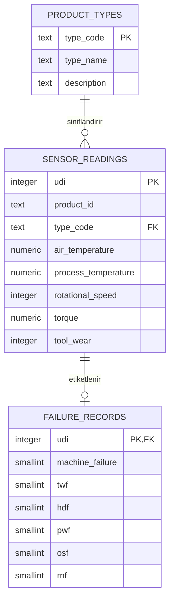

# IndustryPulseAI veritabanı şeması



Her ölçüm tam bir ürün tipine bağlıdır. Bir ürün tipi sıfır veya daha fazla ölçümle ilişkilendirilebilir. `type_code` değerleri `L` (düşük), `M` (orta) ve `H` (yüksek) ürün kalite kategorilerini temsil eder. Tip adı ve isteğe bağlı açıklama, ürün tipi tablosunda saklanır.

Her arıza kaydı tam bir ölçüme bağlıdır. Bir ölçümün sıfır veya bir arıza kaydı olabilir. `failure_records.udi` hem ölçümü işaret eder hem de aynı ölçüm için ikinci bir arıza kaydını önler.

| Ölçüm | Orijinal birim | PostgreSQL tipi |
|---|---|---|
| `air_temperature` | Kelvin (K) | `numeric` |
| `process_temperature` | Kelvin (K) | `numeric` |
| `rotational_speed` | Dakikadaki devir (rpm) | `integer` |
| `torque` | Newton metre (N·m) | `numeric` |
| `tool_wear` | Dakika (min) | `integer` |

Sıcaklıklar pozitif ve sonlu, hız ve aşınma sıfır veya daha büyük, tork sonlu ve sıfır veya daha büyük olmalıdır. Arıza göstergeleri kaynak değerleri `0` ve `1` olarak saklar. `machine_failure` kaynak veri setindeki hedef etiketten alınır. [UCI AI4I 2020 veri sözlüğü](https://archive.ics.uci.edu/dataset/601/ai4i)

`ml_training_data`, arıza kaydı bulunan ölçümleri birleştirir. Girdiler `type_code` ve tablodaki beş ölçümdür. Hedef sütunu `machine_failure` değeridir.

Birincil anahtar indekslerini PostgreSQL oluşturur. Eklenen `sensor_readings_type_code_idx` indeksi, ürün tipine bağlı ölçümlerin bulunmasını destekler. `failure_records.udi` için birincil anahtar indeksi aynı zamanda yabancı anahtar sütununu kapsar.

## Temel kavramlar

| Kavram | Açıklama |
|---|---|
| Data Modeling | Hangi bilgilerin tutulacağını ve aralarındaki ilişkileri tasarlama. |
| Schema | Tabloları, sütunları ve veri kurallarını tanımlayan yapı. |
| Primary Key | Bir tablodaki her satırı benzersiz tanımlayan anahtar. |
| Foreign Key | İlgili satırın başvurulan tabloda bulunmasını gerektiren anahtar. |
| Normalization | Tekrarlanan bilgiyi azaltmak için bilgileri ilişkili tablolarda düzenleme. |
| Constraint | Veritabanının uyguladığı veri kuralı. Örneğin arıza bayrakları yalnızca 0 veya 1 olabilir. |
| Index | Belirli satırların daha hızlı bulunmasına yardımcı olan veri yapısı. |
| View | Bir kayıtlı SQL sorgusunun tablo gibi okunabilen sonucu. |
| Transaction | Birlikte onaylanan veya birlikte geri alınan işlem grubu. |

## Uygulama ve test

Proje kök dizininden çalıştırılır.

```powershell
.\.venv\Scripts\python.exe -m src.init_database
.\.venv\Scripts\python.exe -m unittest discover -s tests -p test_database.py -v
```

Başlatma betiği SQL dosyasını tek transaction içinde uygular. Aynı şema tekrar çalıştırılabilir. Testler kendi transaction’larını geri alır.
