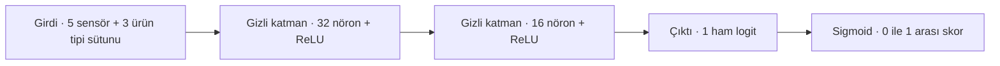
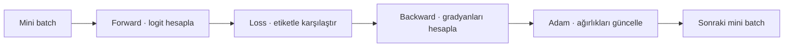

# MLP ile arıza tahmini

## Bir nörondan sinir ağına

**Artificial Neural Network (ANN)**, birbirine bağlı hesaplama birimlerinden oluşan yapay sinir ağıdır. **Nöron** girdileri kendi **weight (ağırlık)** değerleriyle çarpar, sonuçları toplar ve bir **bias (sabit terim)** ekler. Ağırlıklar her girdinin etkisini belirler. Bias, girdiler aynı kalsa bile sonucu sağa veya sola kaydırabilir.

Örneğin ölçeklenmiş tork 2, takım aşınması 1, ağırlıklar 0,5 ve −0,2, bias ise 0,1 olsun. Nöronun ham çıktısı `2 × 0,5 + 1 × (−0,2) + 0,1 = 0,9` olur. **Perceptron**, bu toplama bir eşik uygulayan klasik tek nöronlu sınıflandırıcıdır. Örneğin toplam pozitifse 1, aksi durumda 0 verir.

**MLP (Multi-Layer Perceptron)**, girdileri bir veya daha fazla gizli katmandan geçiren ileri beslemeli bir ağdır. Input Layer veriyi alır, Hidden Layers girdilerden ara temsiller öğrenir, Output Layer son tahmini üretmek için bir ham skor verir.

**ReLU** negatif değerleri sıfırlar, pozitif değerleri olduğu gibi geçirir. Örneğin ReLU(−2) = 0 ve ReLU(0,9) = 0,9. Gizli katmanların doğrusal olmayan ilişkiler öğrenmesini sağlar. **Sigmoid** logiti 0 ile 1 arasına dönüştürür. Logit 0 için skor 0,5 ve logit 0,9 için yaklaşık 0,71 olur. Bu deneyde sıralama metrikleri Sigmoid skorlarıyla hesaplandı. Sınıf tahmini için eşik 0,5 olarak sabitlendi. Ağırlıklı eğitim nedeniyle bu skorlar doğrudan kalibre edilmiş arıza olasılığı olarak yorumlanmamalıdır.

## Ağ nasıl öğrenir?

1. **Forward propagation (ileri yayılım)** girdiyi ağın başından sonuna taşır ve logit üretir. Yüksek tork ile düşük devir bir aradaysa gizli nöronlar bu birlikteliği temsil etmeyi öğrenebilir.
2. **Loss function (kayıp fonksiyonu)** tahminin etiketle uyumsuzluğunu sayıya çevirir. `BCEWithLogitsLoss` Sigmoid ile ikili çapraz entropi hesabını kararlı biçimde birlikte yapar ve doğrudan logit alır. Gerçekte arızalı bir kayda düşük skor vermek daha büyük kayıp üretir. `pos_weight = normal / arıza` arıza örneklerinin kayıptaki etkisini artırır ve her seferinde yalnızca ilgili eğitim katından hesaplanır.
3. **Backpropagation (geri yayılım)** zincir kuralıyla her ağırlığın kaybı nasıl etkilediğini hesaplar. Bu türeve gradyan denir.
4. **Gradient descent (gradyan inişi)** kaybı azaltacak yönde ağırlıkları günceller. Basit bir örnekte ağırlık 0,8, gradyan 0,2 ve öğrenme oranı 0,001 ise güncellenmiş ağırlık 0,7998 olur. **Adam optimizer**, gradyanların ve karelerinin hareketli ortalamalarını kullanarak her parametrenin güncellemesini uyarlayan bir yöntemdir.

**Batch size** bir ağırlık güncellemesine giren örnek sayısıdır. Bu deneyde 64 örnek kullanılır. **Epoch** eğitim verisinin tamamı üzerinden bir geçiştir. Her katta 6.400 eğitim satırı olduğundan bir epoch 100 güncelleme içerir. **Learning rate (öğrenme oranı)** adımın ölçeğini belirler. Çok büyükse güncellemeler kaybı artırabilir, çok küçükse öğrenme yavaşlar. Bu deneyde 0,001 öğrenme oranıyla 50 epoch kullanılır.

## Eğrileri okuma

Eğitim kaybı düşerken doğrulama Average Precision uzun süre düşerse **overfitting (aşırı uyum)** ihtimali vardır. Ağ eğitim örneklerine fazla uyum sağlamış olabilir. Eğitim kaybı yüksek kalır ve doğrulama skoru da düşükse **underfitting (yetersiz uyum)** ihtimali vardır. Eğitim kaybı ve doğrulama AP farklı ölçülerdir. Eğilimleri birlikte okuyun ve tek bir dalgalanmadan teşhis çıkarmayın.

**Machine Learning (makine öğrenmesi)** veriden örüntü öğrenen yöntemlerin genel adıdır. **Deep Learning (derin öğrenme)** çok katmanlı sinir ağlarıyla ara temsilleri de öğrenen bir alt alandır. Örneğin karar ağaçları sensör eşikleriyle dallanırken MLP, eğitim sırasında sensörlerin farklı bileşimlerini gizli nöronlarda öğrenebilir. Hangi yaklaşımın daha iyi olduğu doğrulama sonuçlarına bağlıdır.

## Bu deneyde karşılaştırma

- PostgreSQL görünümünün aynı sıralaması, %80/%20 ayrımı ve beş tabakalı kat yeniden kullanılır. Ön işleme her katın eğitim parçasında öğrenilir. Beş sayısal sütun ile üç ürün tipi sütunu sekiz girdiyi oluşturur.
- Model başlangıcı ve mini batch sırası kat başına 42–46 tohumlarıyla sabitlenir. Her katın 50. epoch sonucu raporlanır. Doğrulama eğrileri öğrenmeyi izlemek içindir. Epoch, eşik ve mimari sonuçlara göre seçilmez.
- Klasik altı model aynı katlarda yeniden değerlendirilir. Model sıralaması beş katın ortalama Average Precision değerine dayanır. ROC ve PR grafikleri, her satırın eğitim dışında kaldığı kattaki skorları bir araya getirir. Grafikteki birleşik ROC-AUC ve AP ile tablodaki kat ortalamaları farklı olabilir.
- Aynı 2.000 satırlık bağımsız test kümesinde XGBoost sonucu önceki aşamada görüldü. Bu nedenle bu küme gelecekteki deneyler için tamamen yeni bir doğrulama kaynağı değildir. MLP deneyinde test bölümü kullanılmadı.

Notebook sonuçları eğitim ortamında çalıştırılmıştır. Proje kökünde `python -m src.train_mlp` komutu aynı değerlendirme akışını çalıştırır. [Çalıştırılmış notebook](../notebooks/05_mlp_deep_learning.ipynb) · [Kat metrikleri](../results/mlp_metrics.csv) · [Yedi modelin karşılaştırması](../results/mlp/model_comparison.csv)

AI4I 2020 verileri sentetiktir. Sonuçlar gerçek fabrikalarda aynı performansı garanti etmez.
