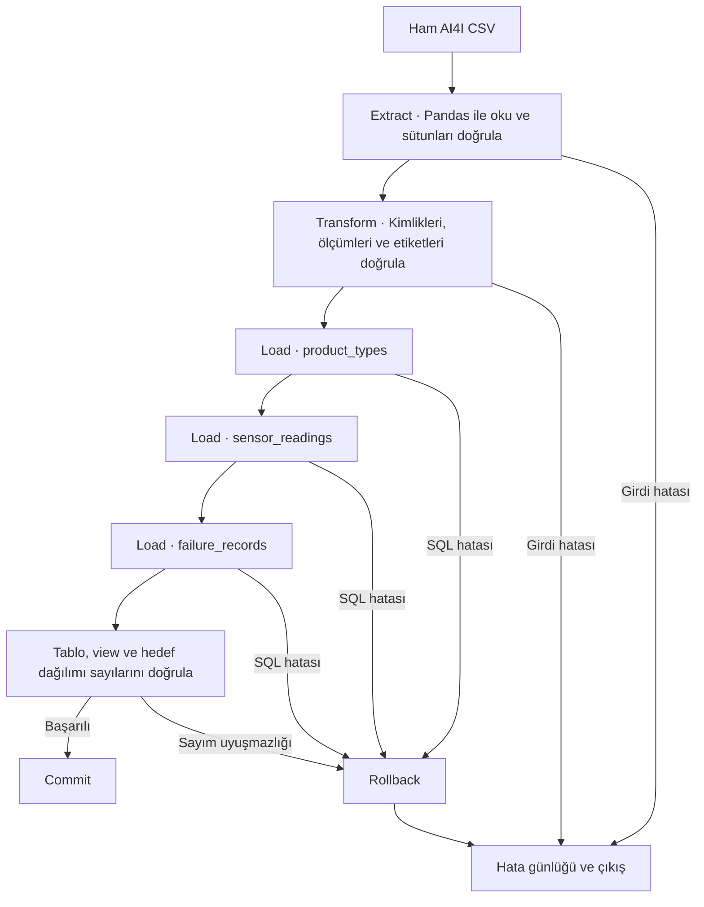

# AI4I toplu veri hattı

**Extract** alanları Pandas ile metin olarak okur. **Transform** sütun adlarını şemaya eşler. Eksik değer, tekrarlanan UDI veya ürün kimliği, geçersiz ürün tipi, şema dışı ölçüm veya ikili arıza göstergesi için satır ve sütun bilgisiyle hata üretir. Sıcaklıklar kelvin, dönüş hızı rpm, tork newton metre ve aşınma dakika cinsinden kalır. Ondalıklı ölçümler PostgreSQL’e `Decimal` olarak gönderilir. Ürün tipleri L (Low), M (Medium) ve H (High) olarak hazırlanır. [UCI veri sözlüğü](https://archive.ics.uci.edu/dataset/601/ai4i)

**Load**, mevcut bağlantı modülünü ve Psycopg `executemany()` yöntemini kullanır. Ürün tipleri `type_code` üzerinden, ölçümler ve arıza kayıtları `udi` üzerinden upsert edilir. Aynı değerler yeniden geldiğinde fiziksel güncelleme atlanır. Üç tablo ve `ml_training_data` sayımları ile hedef dağılımı commit öncesi doğrulanır. Herhangi bir yazma veya sayım hatası bu çalıştırmanın tüm yazmalarını geri alır. [Psycopg transaction belgeleri](https://www.psycopg.org/psycopg3/docs/basic/transactions.html) · [PostgreSQL INSERT belgeleri](https://www.postgresql.org/docs/17/sql-insert.html)

| Kontrol | Beklenen |
|---|---:|
| `product_types` | 3 |
| `sensor_readings` | 10.000 |
| `failure_records` | 10.000 |
| `ml_training_data` | 10.000 |
| Arızasız | 9.661 |
| Arızalı | 339 |

Günlükler başlangıcı, okunan ve doğrulanan kayıtları, tablo başına gönderilen ve değişen kayıtları, sonucu ve toplam süreyi gösterir. PostgreSQL hatalarında günlük mesajı SQLSTATE kodunu kullanır.

## Temel kavramlar

| Kavram | Açıklama |
|---|---|
| ETL | Veriyi kaynaktan al, doğrula ve dönüştür, ardından hedefe yükle. |
| ELT | Veriyi kaynaktan al, hedefe yükle ve dönüşümleri hedef sistemde yap. |
| Data Pipeline | Veriyi bir kaynaktan hedefe taşımak ve işlemek için birbirine bağlı adımlar. |
| Batch Processing | Bir veri grubunu tek çalıştırmada topluca işleme. Bu projede grup bir CSV dosyasıdır. |
| Stream Processing | Sürekli gelen olayları geldikçe işleme. |
| Idempotency | Aynı girdiyi tekrar işlemenin aynı veritabanı durumunu üretmesi. |
| Upsert | Anahtar mevcutsa satırı güncelleme, yoksa ekleme. |
| Bulk Insert | Çok sayıda kaydı toplu bir işlemle ekleme. |
| Logging | İşlemin adımlarını, sonuçlarını ve hatalarını zaman damgasıyla kaydetme. |
| Rollback | Başarısız bir transaction içindeki değişiklikleri geri alma. |
