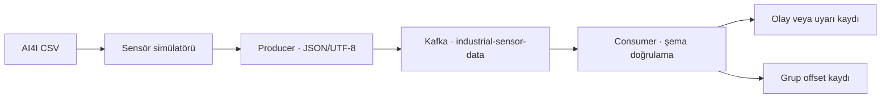

# Kafka ile sensör akışı

**Apache Kafka**, uygulamalar arasında olay taşıyan ve olayları daha sonra tekrar okunabilecek şekilde saklayan bir platformdur. **Event Streaming**, olayların oluştukça gönderilmesi ve okunmasıdır. Bu deneyde AI4I CSV’sindeki satırlar sırayla oynatılır. Her satır gönderilmeden önce yeni bir UUID ve UTC olay zamanı alır. Ölçümler sentetik kaynaktan gelir.



| Kavram | Bu projedeki karşılığı |
| --- | --- |
| **Producer** | Simülatörden olay alır, JSON olarak Kafka’ya gönderir ve broker onaylarını sayar. |
| **Consumer** | Kafka’dan gelen olayları okur, alanları ve türleri kontrol eder, sonucu loglar. |
| **Broker** | Topic verisini saklayan ve istemci isteklerini karşılayan Kafka sunucusudur. Bu kurulumda tek broker vardır. |
| **Topic** | Aynı tür olayların toplandığı isimli akıştır. Sensör olayları `industrial-sensor-data` topic’ine gider. |
| **Partition** | Topic’in kendi sırası olan günlük bölümüdür. Bu topic’in tek partition’ı vardır ve numarası 0’dır. Birden fazla partition olsa sıralama her partition için ayrı sağlanır. |
| **Offset** | Bir kaydın partition içindeki konumudur. Offset 5 işlendiğinde grup bir sonraki okuma konumu olarak 6’yı kaydeder. |
| **Replication factor** | Her partition’ın kaç broker’da kopyasının bulunduğunu belirtir. Bu örnekte 1’dir ve broker kaybına karşı ikinci kopya yoktur. |
| **Consumer Group** | Aynı akışı paylaşarak işleyen tüketicilerin kimliğidir. Bir partition aynı anda bir grubun tek üyesine atanır. Farklı grupların okuma konumları birbirinden bağımsızdır. |
| **KRaft** | Kafka’nın cluster metadatasını yöneten Raft tabanlı protokoldür. Burada broker ve controller rolleri aynı süreçte çalışır. |
| **Serialization** | Bir Python sözlüğünün taşınabilir baytlara dönüştürülmesidir. Producer JSON’u UTF-8 kodlar, consumer baytları tekrar JSON olarak ayrıştırır. |

**Batch Processing (toplu işleme)**, örneğin 10.000 sensör ölçümünü bir kerede PostgreSQL’e yükleyen mevcut ETL işidir. **Stream Processing (akış işleme)**, örneğin her yeni sensör olayını ulaşır ulaşmaz doğrulayıp loglamaktır. Bu uygulama doğrulama ve loglama yapar. Sensör olayları eğitim tablolarına yazılmaz.

## Yerel kurulumu başlatma

Kafka ayrı `streaming` profilindedir. Yalnızca Kafka’yı başlatan şu komutları proje kökünde çalıştırın.

```powershell
docker compose --profile streaming up -d --wait kafka
docker compose exec -T kafka /opt/kafka/bin/kafka-topics.sh --bootstrap-server kafka:29092 --create --if-not-exists --topic industrial-sensor-data --partitions 1 --replication-factor 1
docker compose exec -T kafka /opt/kafka/bin/kafka-topics.sh --bootstrap-server kafka:29092 --describe --topic industrial-sensor-data
```

Windows istemcileri `127.0.0.1:9092` kullanır. Compose ağındaki yönetim komutları `kafka:29092` kullanır. Controller portu host’a yayımlanmaz. Kafka’nın ayrı kalıcı volume’u ve 256–512 MiB JVM heap aralığı vardır. Toplam süreç belleği heap’ten daha yüksek olabilir. `docker compose --profile streaming stop kafka` yalnızca Kafka’yı durdurur ve verisini saklar.

## Bir olayın içinde ne var?

```json
{
  "event_id": "55fa6431-ad9b-480a-8853-cf34c34bf1c2",
  "event_time": "2026-11-25T09:00:00Z",
  "product_type": "M",
  "air_temperature": 298.1,
  "process_temperature": 308.6,
  "rotational_speed": 1551,
  "torque": 42.8,
  "tool_wear": 0
}
```

Sıcaklıklar kelvin, dönüş hızı rpm, tork N·m, takım aşınması dakika cinsindendir. Devir ve aşınma tam sayıdır. Arıza etiketi ve arıza türü bayrakları olay şemasının dışındadır. Olay zamanı, ölçümün oynatıldığı simülasyon anıdır. Dosya sona erdiğinde simülatör başa döner ve yeni kimlikler üretir.

## Grup ve offset deneyi

Önce üç olay gönderin. Ardından yeni bir grupta bir kayıt okuyun ve aynı grupla yeniden başlatın. Topic’te önceki kayıtlar varsa bu grup elde tutulan en eski kayıttan başlar.

```powershell
.\.venv\Scripts\python.exe -m streaming.kafka_producer --count 3 --interval 0.5
$sensorGroup = "sensor-demo-" + [guid]::NewGuid().ToString("N")
.\.venv\Scripts\python.exe -m streaming.kafka_consumer --group $sensorGroup --count 1
.\.venv\Scripts\python.exe -m streaming.kafka_consumer --group $sensorGroup --count 1
docker compose exec -T kafka /opt/kafka/bin/kafka-consumer-groups.sh --bootstrap-server kafka:29092 --describe --group $sensorGroup
```

İkinci consumer, ilk çalıştırmanın işlediği offset’in bir sonrasından devam eder. Farklı bir grup `earliest` ile en eski elde tutulan kayıttan başlayabilir. `--start latest` yalnızca grup için geçerli kayıtlı offset yoksa kullanılır. `--count` bırakılırsa program Ctrl+C ile durdurulana kadar çalışır. Producer varsayılan olarak saniyede bir olay gönderir.

Consumer geçersiz JSON veya geçersiz alan gördüğünde partition, offset ve nedeni uyarı olarak yazar. Sonra offset’i kaydeder. Böylece bozuk kayıt aynı grubu tekrar tekrar durdurmaz. Logdan sonra, offset kaydından önce süreç kesilirse aynı olay yeniden okunabilir. Producer’ın idempotent gönderimi, aynı producer oturumundaki broker tekrar denemelerinden kaynaklanabilecek kopyaları engeller.

## Uçtan uca doğrulama

Kafka ve PostgreSQL çalışırken aşağıdaki komut, broker gerektiren testi de etkinleştirir. Ölçülen offset aralığını başka bir producer ile paylaşmamak için deneme producer’ını önce durdurun.

```powershell
$env:RUN_KAFKA_TESTS = "1"
.\.venv\Scripts\python.exe -m unittest discover -s tests -v
Remove-Item Env:RUN_KAFKA_TESTS
```

Entegrasyon testi topic’in son offset’ini başlangıç sınırı olarak alır. Üretilen ve tüketilen 100 UUID’yi, mesaj içeriklerini, offset dizisini ve yeniden başlatılan grubun kayıtlı konumunu karşılaştırır. Böylece daha önce topic’e yazılmış olaylar yeni ölçüme karışmaz.
