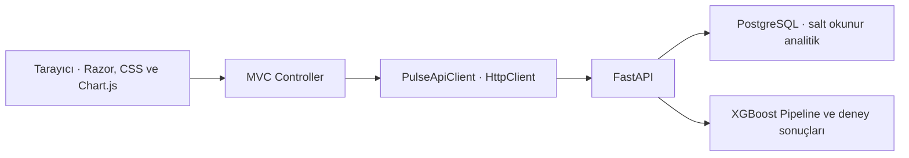

# ASP.NET Core MVC Dashboard

IndustryPulseAI Dashboard, İngilizce arayüz sunan bir .NET 10 MVC uygulamasıdır. PostgreSQL’e FastAPI üzerinden erişir. Sensör sayıları ve son olaylar PostgreSQL’den, model grafikleri ise önceki çalışmalarda üretilmiş CSV dosyalarından gelir.



| Kavram | Bu projede nasıl kullanılır? |
| --- | --- |
| **MVC** | Kullanıcı isteğini alan kodu, veriyi ve arayüzü ayrı sorumluluklara bölen mimari. |
| **Model** | Sensör olayı, servis durumu veya tahmin yanıtı gibi verilerin yapısını tanımlar. |
| **View** | Razor şablonuyla HTML üretir. Örneğin Sensor Monitor görünümü sıcaklık ve tork grafiğini barındırır. |
| **Controller** | İstekleri karşılar, servisten veri ister ve uygun View’ı döndürür. |
| **ViewModel** | Bir ekranın ihtiyaç duyduğu veriyi ve hata durumunu bir araya getirir. Overview örneğinde sayımlar ve servis sağlığı ayrı kaynaklardan gelir. |
| **Service Layer** | `PulseApiClient`, HTTP isteği ve JSON okuma işini Controller’dan alır. |
| **Dependency Injection** | ASP.NET Core, `PulseApiClient` nesnesini Controller’a verir ve `HttpClient` yapılandırmasını merkezi olarak uygular. |
| **HttpClient** | MVC sunucusundan FastAPI’ye HTTP isteği gönderen .NET aracıdır. |
| **Razor** | C# ile HTML’i birleştirir. Örneğin sensör listesinden tablo satırları üretir. |
| **Routing** | `GET /model-analytics` gibi bir yolun hangi Controller işlevine gideceğini belirler. |
| **Separation of Concerns** | Arayüz, HTTP iletişimi, model tahmini ve SQL sorguları ayrı yerlerde tutulur. |
| **Frontend ve Backend** | Tarayıcıdaki HTML, CSS ve Chart.js frontend’dir. MVC sunucusu ve FastAPI backend görevlerini paylaşır. |
| **API Integration** | MVC formu verileri doğrular ve FastAPI’ye JSON gönderir. FastAPI tahmin sonucunu döndürür, MVC sonucu sayfaya yerleştirir. |

## Çalıştırma

Proje kökünden önce PostgreSQL’i çalıştırın. Kafka’yı mevcut akışı veya broker sağlık kontrolünü kullanacaksanız başlatın. PostgreSQL’de eğitim verileri ve model dosyası zaten varsa yeniden yüklemeye gerek yoktur.

```powershell
docker compose up -d --wait postgres
docker compose --profile streaming up -d --wait kafka
.\.venv\Scripts\python.exe -m uvicorn api.main:app --host 127.0.0.1 --port 8000
```

Ayrı bir PowerShell oturumunda:

```powershell
dotnet run --project dashboard/IndustryPulse.Web/IndustryPulse.Web.csproj --no-launch-profile
```

[Dashboard](http://127.0.0.1:5080/) · [FastAPI Swagger](http://127.0.0.1:8000/docs)

Sensor Monitor her 15 saniyede saklanan son 30 olayı kontrol eder. Kayıtlar değişmemişse bunu açıkça yazar. Yeni olay eklemek için mevcut Kafka producer ve Spark Structured Streaming adımlarını kullanın. Kafka sağlık kontrolü broker metadata’sını ve sensör topic’ini sorgular. Sürekli Spark sorgusu için bir çalışma durumu kaynağı bulunmadığından Spark `Unknown` görünür. [Kafka rehberi](kafka_streaming.md) · [Spark rehberi](spark_processing.md)

Data Pipeline sayfası güncel sayım süresini ve mevcut veritabanında ölçülmüş ETL tekrarının süresini ayrı gösterir. ETL ölçümü CSV okuma, doğrulama, upsert ve sayım adımlarını içerir. En dış transaction geri alındı. Ölçüm dolu veritabanındaki tek bir yerel tekrardır.

Model Analytics yedi modelin beş katlı doğrulama ortalamalarını ve XGBoost’un bağımsız testini ayrı gösterir. MLP grafiği her epoch için katların ortalama eğitim kaybını gösterir. AI Prediction skoru kalibre edilmiş bir arıza olasılığı değildir. Model sentetik AI4I verileriyle eğitilmiştir.

## Doğrulama

Tarayıcı testi Node.js 22+ ve yerel Chrome kullanır. Gerekirse `CHROME_BIN` ile Chrome yolunu belirtin. Ekran görüntüleri Git dışında kalan `tmp/` dizinine yazılır.

```powershell
dotnet build dashboard/IndustryPulse.Web/IndustryPulse.Web.csproj
.\.venv\Scripts\python.exe -m unittest discover -s tests -p test_dashboard_analytics.py -v
node dashboard/tests/browser-smoke.mjs
```

FastAPI kapalı, Dashboard açıkken `node dashboard/tests/browser-smoke.mjs --offline` komutu kesinti senaryosunu çalıştırır. Tam Python test takımının Kafka ve Spark adımları Spark rehberindedir. [Test ortamları](spark_processing.md#çalıştırma)
