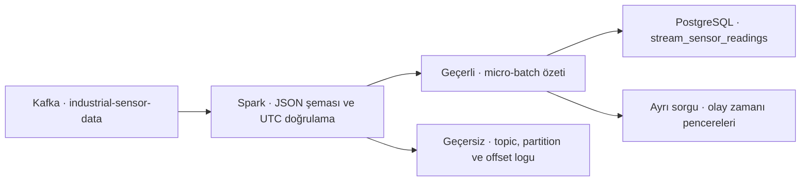

# Spark ile toplu veri ve sensör akışı

## Ortam

| Bileşen | Kullanılan sürüm |
| --- | --- |
| Python | 3.12, mevcut `.venv` |
| Java | Microsoft OpenJDK 17 |
| PySpark / Apache Spark | 4.1.2 |
| Scala / Kafka connector | 2.13 / `org.apache.spark:spark-sql-kafka-0-10_2.13:4.1.2` |
| Kafka / PostgreSQL | Mevcut Kafka 4.2.2 ve PostgreSQL 17 |
| PostgreSQL istemcisi | Mevcut Psycopg 3 |

Spark 4.1.2, Java 17/21 ve Python 3.10 veya üstünü destekler. Kafka connector aynı Spark sürümü ve Scala serisiyle eşleşir. Resmi connector rehberi Kafka 0.10 veya üzerini destekler. [Spark 4.1.2 gereksinimleri](https://spark.apache.org/docs/4.1.2/) · [Kafka connector rehberi](https://spark.apache.org/docs/4.1.2/structured-streaming-kafka-integration.html)

Spark `local[2]` ile aynı bilgisayarda iki görev iş parçacığı kullanır. JVM heap hedefi 1 GiB, shuffle partition sayısı 2’dir. İlk akış çalıştırması connector ve bağımlılıklarını Maven’den indirir. Varsayılan checkpoint ve Ivy önbelleği `.spark/` altındadır ve Git kapsamı dışındadır.

## Temel kavramlar

| Kavram | Örnek |
| --- | --- |
| **Apache Spark** | Veri okumayı, sorgulamayı ve toplulaştırmayı planlayan bir işlem motorudur. |
| **PySpark** | Spark’ın Python arayüzüdür. Python koduyla JVM’de çalışacak bir plan tanımlarsınız. |
| **Distributed Computing** | İşin parçalara bölünüp farklı kaynaklarda paralel yürütülmesidir. Burada iki iş parçacığı aynı bilgisayardadır. |
| **Driver ve Executor** | Driver işi planlar ve görevleri izler. Executor görevleri yürütür. Yerel modda bu roller aynı JVM’de çalışır. |
| **Spark DataFrame** | Adlandırılmış ve türü belirli sütunlardan oluşan tablo görünümüdür. |
| **Spark SQL** | DataFrame üzerinde SQL ile sorgu yürütür. Örneğin ürün tipine göre arıza sayısını hesaplar. |
| **Lazy Evaluation** | Spark, dönüşümleri plan olarak biriktirir ve sonuç istendiğinde yürütür. |
| **Transformation ve Action** | `where` bir filtre planlar. `count`, `show` veya `collect` planı çalıştırır. |
| **Structured Streaming** | Sürekli gelen olayları büyüyen bir tablo gibi işler. |
| **Micro-Batch** | Spark’ın tek seferde işlediği küçük olay grubudur. Normal akış beş saniyelik tetikle çalışır ve tetik başına en çok 1.000 Kafka offset’i hedefler. |
| **Checkpoint** | Bir sorgunun okuduğu Kafka offset’lerini ve varsa pencere durumunu diskte tutar. Aynı sorgu aynı checkpoint ile yeniden başlamalıdır. |
| **Window Aggregation** | Örneğin 12.00–12.01 UTC arasında gerçekleşen olayları gruplayıp ortalama torku hesaplar. |
| **Watermark** | Spark’ın geç gelen olayları desteklerken ne kadar pencere durumu tutacağına karar vermesine yardım eder. |
| **Fault Tolerance** | Hata sonrası eski durumdan devam edebilme yeteneğidir. Burada checkpoint yeniden okumayı yönetir, PostgreSQL benzersiz anahtarı tekrar yazılan olayları engeller. |

**Pandas ve PySpark.** Pandas tabloyu Python işlem belleğinde işler. PySpark veriyi bölümlere ayırabilir ve birden fazla makinede de çalıştırabilir. JVM başlatma ve görev zamanlama maliyetleri nedeniyle 10.000 satır gibi küçük bir veri setinde Spark her zaman daha hızlı değildir.

**Kafka ve Spark.** Kafka olayları sıralı partition günlüğünde saklar ve dağıtır. Spark Kafka’dan okunan olayları doğrular, toplulaştırır ve PostgreSQL’e yazar.

## Batch ve SQL karşılaştırması

`spark_batch.py` CSV’yi 14 sütunlu açık şemayla okur. 10.000 satırın dolu olduğunu ve UDI’nin benzersiz olduğunu denetler. Spark SQL dokuz PostgreSQL analitik sorgusunu yeniden üretir. Kapsama genel özet, ürün oranları ve grupları, sensör ortalamaları, yüksek tork kayıtları ve sıraları, aşınma grupları ve arıza türleri dahildir. PostgreSQL’e özgü iki fiziksel yürütme planı ayrı kalır. Testler dokuz sorgunun sonuçlarını PostgreSQL ile, genel özeti ve ortalamanın üzerinde tork sayısını Pandas ile karşılaştırır.

## Akış, transaction ve pencere



Akış ürün tipini, UUID’yi, UTC zamanını, zorunlu alanları ve sensör aralıklarını kontrol eder. Her micro-batch toplam, geçerli ve geçersiz olay sayılarını, ortalama torku ve iki sıcaklık ortalamasını loglar. Geçersiz olayların konumu loglanır. Sıcaklıklar sonlu ve pozitif, devir, tork ve aşınma sıfır veya daha büyük olmalıdır.

Veritabanı yazımı her micro-batch için tek transaction kullanır. Bir yazma hatasında önceki gruplar da rollback edilir. `foreachBatch` varsayılan olarak **at-least-once** yazma garantisi sunar. Örneğin veritabanı commit’inden sonra Spark checkpoint’i tamamlamadan durursa aynı batch tekrar yürütülebilir. UUID primary key ve `ON CONFLICT DO NOTHING` aynı olayın ikinci satır oluşturmasını engeller. Bu idempotent tablo yazımı genel bir **exactly-once** garantisi sağlamaz. [Spark Structured Streaming kılavuzu](https://spark.apache.org/docs/4.1.2/streaming/apis-on-dataframes-and-datasets.html)

Pencere sorgusu ayrı bir checkpoint kullanır. Bir dakikalık UTC pencerelerini iki dakikalık watermark ile günceller. Örneğin gözlenen en yeni olay zamanı 12.05 ise watermark sonraki batch’lerde yaklaşık 12.03’e ilerler. Spark yeterince eski pencerelerin durumunu temizleyebilir. 12.00 penceresine sonradan gelen olay artık pencere hesabına alınmayabilir. PostgreSQL’e ham geçerli olay yazan sorgu pencere filtresinden bağımsız çalışır.

## Çalıştırma

Mevcut PostgreSQL ve Kafka sağlıklı durumdayken proje kökünden, `JAVA_HOME` Java 17 veya 21’i gösterirken çalıştırın.

```powershell
.\.venv\Scripts\python.exe -m pip install -r requirements.txt
.\.venv\Scripts\python.exe -m streaming.spark_batch
.\.venv\Scripts\python.exe -m streaming.spark_streaming --available-now
.\.venv\Scripts\python.exe -m streaming.spark_streaming --windows --available-now
```

`--available-now` başlangıçta mevcut Kafka verisini işleyip çıkar. Sürekli dinlemek için parametreyi kaldırın. İlk başlangıç varsayılan olarak `earliest` kullanır. Yeni bir checkpoint ile `--starting-offsets latest` veya Kafka partition’ına özel başlangıç JSON’u verilebilir. Mevcut checkpoint varsa Spark oradaki konumu kullanır.

Yerel Spark çalışabilen bir ortamda tam test için üç entegrasyon seçeneğini etkinleştirin. Kafka offset aralığı ölçülürken başka producer çalıştırmayın.

```powershell
$env:RUN_KAFKA_TESTS = "1"
$env:RUN_SPARK_TESTS = "1"
$env:RUN_SPARK_STREAM_TESTS = "1"
.\.venv\Scripts\python.exe -m unittest discover -s tests -v --durations 5
```

### Windows’ta yerel çalıştırıcı

Hadoop, Windows’ta yerel dosyalara erişmek için `hadoop.dll` ve `winutils.exe` bileşenlerini ister. Bu bilgisayarda bu bileşenler eksikti. Doğrulamada Python 3.12 ve Java 17 içeren, komut bitince silinen bir Linux container kullanıldı. Spark hâlâ `local[2]` modundadır. Çalıştırıcı mevcut Compose ağına bağlanır ve mevcut `.venv` içindeki Spark paketini salt okunur olarak kullanır. [Apache Hadoop Windows gereksinimleri](https://cwiki.apache.org/confluence/spaces/HADOOP2/pages/120730292/WindowsProblems)

```powershell
.\.venv\Scripts\python.exe -m pip install -r requirements.txt
docker build -t industrypulse-spark-local -f streaming/spark-local.Dockerfile streaming
$projectPath = (Get-Location).Path
$sparkNetwork = docker inspect --format '{{range $name, $net := .NetworkSettings.Networks}}{{$name}}{{end}}' industrypulse-postgres
$sparkRunner = @(
    '--rm', '--network', $sparkNetwork, '--memory', '3g',
    '--mount', "type=bind,source=$projectPath,target=/workspace",
    '--mount', "type=bind,source=$projectPath/.venv/Lib/site-packages/pyspark,target=/opt/pyspark-runtime/pyspark,readonly",
    '-e', 'POSTGRES_HOST=postgres', '-e', 'POSTGRES_PORT=5432',
    '-e', 'SPARK_KAFKA_BOOTSTRAP=kafka:29092'
)
docker run @sparkRunner industrypulse-spark-local python -m streaming.spark_batch
docker run @sparkRunner industrypulse-spark-local python -m streaming.spark_streaming --available-now
docker run @sparkRunner industrypulse-spark-local python -m streaming.spark_streaming --windows --available-now

$env:RUN_KAFKA_TESTS = "1"
.\.venv\Scripts\python.exe -m unittest discover -s tests -v --durations 5
docker run @sparkRunner -e RUN_SPARK_STREAM_TESTS=1 industrypulse-spark-local python -m unittest discover -s tests -p test_spark.py -v --durations 5
```

Windows komutunda Spark testleri atlanır ve hemen sonraki container komutunda çalışır. Aynı çalıştırıcı notebook kernel’ini çalıştırabilir. Notebook, Kafka pencerelerini gösterir ve akış tablosunu salt okunur sorgular.

[Çalıştırılmış notebook](../notebooks/06_spark_data_processing.ipynb) · [Akış tablosu SQL’i](../sql/03_streaming_schema.sql)

## Doğrulama sonuçları

Spark, Pandas ve PostgreSQL toplam 10.000 kayıt ve 339 arıza verdi. Arıza oranı %3,39 oldu. Dokuz analitik sorgunun sonuçları eşleşti. Yeni olaylar mevcut Kafka günlüğünün sonundan ayrı bir offset aralığında doğrulandı.

| Akış senaryosu | Gözlenen sonuç |
| --- | --- |
| 100 yeni olay | Offset 200–299 aralığındaki 100 benzersiz UUID ve UTC zamanları PostgreSQL ile eşleşti. |
| Yeni Spark işlemi, aynı checkpoint | Yeni mesaj yokken 0 olay okundu. |
| 100 tekrar ve 1 hatalı mesaj | 101 mesaj okundu, 0 satır eklendi ve 1 geçersiz olay loglandı. |
| Transaction hatası | İkinci yazma grubundaki SQL kısıt ihlali ilk grubun yazımını da geri aldı. |
| Pencere sorgusu | Bir dakikalık olay zamanı pencereleri ayrı checkpoint ile hesaplandı. |

| Test grubu | Başarılı | unittest süresi | Tepe süreç ağacı RSS |
| --- | ---: | ---: | ---: |
| Mevcut testler, Windows `.venv` | 25 | 8,58 sn | 437,7 MiB |
| Spark testleri, yerel Linux çalıştırıcı | 4 | 85,06 sn | 1.641,5 MiB |

Spark ölçümü ilk Maven çözümlemesini içerir. Çapraz batch karşılaştırması 13,40 sn, uçtan uca akış senaryosu 31,25 sn sürdü. RSS, test Python işlemi ve alt süreçlerinde yaklaşık 250 ms aralıklarla örneklendi. Docker’daki Kafka ve PostgreSQL süreçleri ayrı kaldığı için bu RSS değerlerine dahil değildir. Spark testindeki tepe nokta yeni Spark işlemiyle yapılan checkpoint kontrolünü de kapsar.
